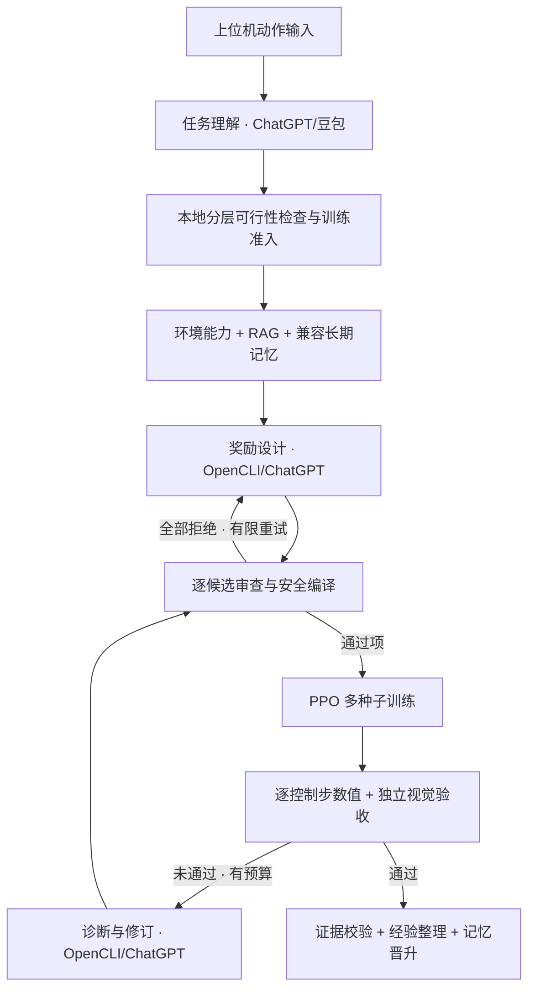

# 自然语言四足机器人强化学习训练 Agent

本项目把自然语言动作要求转换为可审计的强化学习实验：GPT/OpenCLI 任务理解 Agent 输出 `TaskIntentSpec`，训练前 `Task Feasibility Pipeline` 按能力、运动学、静态几何/动力学、轨迹和物理证据分层。真实 backend、Pinocchio 与 Mock 严格区分，缺失数据为 `UNKNOWN/INCONCLUSIVE`。Go2 预检复用 PPO 环境和 URDF，不依赖转换 MJCF、不训练策略。直线行走原型包含 gait 与足端轨迹，经 Pinocchio 多脚 IK、限位检查和 Isaac Gym rollout；只有实际证据通过才报告动态物理通过。倒立、跳跃、转向与特技所需专用全身求解后端尚未全部实现，不把求解计划当作物理证明。默认预算探索可对能力和仿真环境已确认的任务进行有限训练，但不改变探针失败结论和验收标准。上下文构建器合并动作约束、风险、预算、环境、RAG 和记忆，默认通过 OpenCLI/ChatGPT 设计奖励，独立审查/编译后进入 PPO，最后联合数值与视觉验收。

训练准入配置在 `config/agent.yaml`：`feasibility_admission_mode: budgeted_exploration` 默认最多允许探索 `3000` 次累计 PPO 迭代、`1` 次奖励修订；改为 `strict` 则必须目标物理探针通过。实际额度取任务预算和本地上限的较小值，恢复不会重置额度。上位机分别显示物理结果与准入决定；详见 [训练前动作预检与准入](docs/agent/TASK_FEASIBILITY.md)。这不是自动降低验收标准，也不代表已学会动作。

当前主要操作入口是本地桌面上位机。所有项目配置均使用相对路径，项目目录整体移动或上传后无需修改主机路径。

## 系统架构图



完整可编辑图见 `docs/agent/images/rl-agent-architecture-v2.mmd`；目录内旧 PNG 为历史图，不作为当前角色路由依据。完整模块、协议、状态机、闭环、产物、安全边界见 `docs/agent/AGENT_COMPLETE_GUIDE.md`。

该系统采用自研的确定性状态机编排多 Agent 闭环，没有依赖 LangGraph、CrewAI 等 Agent 编排框架。默认奖励设计、诊断、修订与经验总结通过 OpenCLI 使用 ChatGPT；任务理解与视觉评价按配置使用 ChatGPT/豆包主备。本地协调器负责上下文构建、提示词编译、奖励审查、安全校验、训练执行、确定性验收、四层记忆治理、状态持久化和断点恢复。各模型 Agent 通过结构化 JSON 交接；PPO 和最终安全判定由本地流程控制。

训练前动作可行性预检的模块、状态门控、依赖降级和当前真实能力限制见 [`docs/agent/TASK_FEASIBILITY.md`](docs/agent/TASK_FEASIBILITY.md)。

## 快速启动

在 `rl_agent` 目录双击 `启动上位机.sh`，或在终端执行：

```bash
conda activate rl_agent
./启动上位机.sh
```

也可以直接启动桌面入口：

```bash
conda activate rl_agent
python -m rl_training_agent desktop
```

如果终端已经位于 `rl_agent`，不要再次执行 `cd rl_agent`。如果位于上一级目录，才需要先执行 `cd rl_agent`。

建议首次选择“离线演练”，确认整条链路正常后再选择“真实训练”。默认奖励设计和诊断使用 OpenCLI/ChatGPT 聊天模式；只有配置为 `opencli-doubao` 的任务理解与视觉角色才会回退豆包。训练使用 Isaac Gym GPU 仿真，不会连接或部署到实体机器人。

默认配置不需要百炼 API Key。只有将奖励设计或诊断角色显式改成 `bailian` 时，才需要本地密钥配置，填写一次后上位机和命令行都会自动读取：

```bash
cp .env.example .env
```

然后只编辑 `.env` 中的：

```bash
DASHSCOPE_API_KEY="你的百炼 API Key"
```

`.env` 已被 Git 忽略，不会随代码上传。如果终端另外设置了同名环境变量，终端的值优先。
使用业务空间专属域名时，直接在 `.env` 中修改 `DASHSCOPE_BASE_URL`。

不要把 API Key 写入 `config/bailian.yaml` 或任何实验文件。

网页推理的模式与主备策略已经默认配置完成，无需填写豆包 API Key：`config/opencli.yaml` 的 `force_chat_mode: true` 强制 ChatGPT 使用“聊天”，`config/agent.yaml` 中角色的 `opencli-doubao` 表示该角色在 ChatGPT 故障时自动切换到已登录的豆包“对话”。首次使用豆包备用链路时，只需在安装 Browser Bridge 的 Chrome 中登录一次豆包。

## 可靠性与恢复约束

完整修复说明、旧实验兼容行为及验证边界见 [可靠性修复说明](docs/agent/RELIABILITY_FIXES.md)。安全证据缺失不再默认按零处理；物理轨迹逐控制步采样，视频独立降采样。全部奖励候选被拒绝时，`reward_design_review_retries` 控制带上下文的有限次重新设计。同任务训练/恢复互斥，同一浏览器 profile 的网页请求跨进程串行化。长期记忆按机器人、环境源码/资产指纹和奖励注册表版本硬过滤，缺少版本的旧记忆保留但不会进入生产奖励上下文。

登录误报、消息归属、停止进程、GPU 租约、接口访问和记忆证据的新增约束见 [系统边界加固](docs/agent/SECURITY_FIXES.md)。GPT 保持登录却反复报过期时，旧实现可能把“奖励注册表”误当登录提示；新实现只检查站点控件。应用修改后重启上位机；有剩余额度且动作、配置、环境和策略证据一致时，才允许“从当前策略继续闭环”。上位机现在仅允许本机访问，打开首页会自动初始化会话，无需新增密钥配置。

动作语义、接触合同和预算展示的本轮优化见 [2026-10 项目优化说明](docs/agent/OPTIMIZATION_2026_10.md)。输入“侧向翻滚”时须明确贴地侧滚还是腾空侧翻；否定句不会触发空翻模板。PPO 训练结束、联合验收通过和预算耗尽分别展示，预算耗尽后不再自动恢复或请求模型。接触硬约束不会因动作名称而自动豁免。

## 上位机工作流

1. 输入希望训练的动作、速度、地形和禁止行为。
2. 选择与训练配置对应的机器人。
3. 选择“离线演练”或“真实训练”，点击“下发训练任务”。
4. 在“学习遥测”查看任务理解、可行性预检、经验检索、奖励设计、训练、评估和记忆整理阶段，在“动作可行性”查看约束→规划→全身求解→物理证据链。
5. 在“四层记忆”查看当前任务工作记忆、晋升原因，以及全局情景/语义/程序记忆状态。
6. 只有状态为“训练完成”时，才表示视觉目标、任务物理指标与硬安全约束全部通过。
7. “等待人工复核”会显示具体原因。仅当 checkpoint、冻结预算及恢复前置条件有效时显示“从当前策略继续闭环”；耗尽或额度未知时禁止恢复，不会重置额度。已通过验收的策略仍可播放。

状态含义：

- `COMPLETED`：联合验收通过，训练完成；
- `HUMAN_REVIEW`：Provider 暂时不可用、证据存在真实冲突、修订无法安全执行或自动预算耗尽；
- `FAILED`：训练进程或确定性流程失败；
- `FULL_TRAINING`、`VISUAL_EVALUATING`、`DIAGNOSING` 等：闭环仍在运行。

## 查看策略效果

训练完成后，可在带图形桌面的终端播放最终策略：

```bash
python -m rl_training_agent play \
  --task-id task-xxxxxxxxxx \
  --checkpoint experiments/task-xxxxxxxxxx/final/checkpoint.pt
```

`task-id` 可从上位机“实验编号”读取。`play` 会自动使用 checkpoint 同目录中的编译配置。路径必须位于该任务目录内，并使用相对于 `rl_agent` 的路径。

查看训练前动态可行性检验过程（不是播放已训练策略）：

```bash
python -m rl_training_agent feasibility-view \
  --task "Go2 倒退走 0.3m/s 5秒" \
  --robot go2 \
  --max-seconds 5
```

该命令会打开 Isaac Gym Viewer，并在结束后输出确定性指标；当前只支持 Go2 前进/后退动作。完整边界见 [`docs/agent/TASK_FEASIBILITY.md`](docs/agent/TASK_FEASIBILITY.md)。


## 清理实验磁盘空间

先预览可安全回收的空间，不会删除文件：

```bash
python -m rl_training_agent cleanup-experiments
```

确认后执行清理：

```bash
python -m rl_training_agent cleanup-experiments --apply
```

如果只清理失败、淘汰和未入选视觉样本的视频，不删除中间 checkpoint：

```bash
python -m rl_training_agent cleanup-experiments --videos-only --apply
```

也可以追加 `--task-id task-xxxxxxxxxx` 只清理一个任务。清理器保留最终归档策略、manifest 引用的恢复点、每个训练运行的最新 checkpoint、最差/中央/最好视觉样本以及全部数值汇总和 parquet 轨迹，只删除中间 checkpoint、未入选视觉样本的 MP4 和反事实测试 MP4。默认每个随机种子只录制一次确定性 rollout，避免生成重复视频。

## 命令行检查

以下命令都应在 `rl_agent` 目录运行：

```bash
# 检查 Python、Isaac Gym、CUDA、训练工程和 OpenCLI
python -m rl_training_agent doctor

# 扫描指定机器人可用的奖励、观测量和验收指标
python -m rl_training_agent inspect-env --robot go2

# 重建本地 RAG 索引
python -m rl_training_agent rag-index

# 检查某个动作能够检索到哪些训练经验
python -m rl_training_agent rag-query \
  --query "Go2 后腿站立行走的奖励设计" \
  --robot go2 \
  --top-k 5

# 查看已晋升长期记忆，并测试动作记忆检索
python -m rl_training_agent memory-stats
python -m rl_training_agent memory-query \
  --query "Go2 后腿站立行走" \
  --robot go2

# 执行一个固定动作基准的离线控制链验证
python -m rl_training_agent benchmark \
  --suite config/benchmarks.yaml \
  --case forward_walk \
  --provider mock \
  --dry-run

# 预览旧产物格式迁移
python -m rl_training_agent migrate-artifacts

# 测试 OpenCLI 文本与图片链路
python -m rl_training_agent opencli-test

# 查看任务状态与报告
python -m rl_training_agent status --task-id task-xxxxxxxxxx
python -m rl_training_agent report --task-id task-xxxxxxxxxx
```

运行自动测试时禁用系统 ROS 自动注入的 pytest 插件：

```bash
PYTEST_DISABLE_PLUGIN_AUTOLOAD=1 python -m pytest -q
```

在已激活的 `rl_agent` 环境中，可用独立会话排查 ChatGPT 通信。默认只读；
`--send --rounds 2` 会新建聊天并连续发送两次相同的无敏感信息 JSON 自检提示，
验证提交确认和回复归属，不启动训练：

```bash
python scripts/opencli_direct_debug.py /tmp/rl-opencli-check --session rl-opencli-check
python scripts/opencli_direct_debug.py /tmp/rl-opencli-check --session rl-opencli-check --send --rounds 2
```

提交成功要求新的用户消息全文匹配；输入框清空或点击成功均不能单独证明提交。
回复读取兼容新旧消息 DOM，要求回复属于本次用户消息，且生成结束、正文稳定。
无法确认提交时不会重复点击。诊断目录包含页面和对话正文，请留在本地。

附件上传使用页面 File 对象和 React 上传处理器；`input.files` 在处理器执行后
可能被清空，不能据此判断上传失败。需求文档必须在编辑器中出现文件名预览，
不能用历史消息中的同名文件或图片预览代替。发送在页面内点击可见且可用的按钮，
提交校验兼容“文件”“文档”“代码”附件标签。Provider 修复后可在上位机再次
选择“从当前策略继续闭环”，新进程会加载新代码并复用已有 checkpoint。

倒立前进的速度验收使用水平航向坐标（`velocity_frame: heading`）和
`front_leg_forward_speed`（m/s）；`front_leg_walk_velocity_tracking` 仍是无量纲
得分，不能作为 m/s 阈值。训练奖励使用相同的水平坐标转换。学习阶段标记为
`TaskPhase.scope: training`，用户明确要求的动作内阶段标记为 `execution`。
最终策略录像不需要重演学习阶段，足端滑移、碰撞和姿态检查仍然保留。

旧任务可先只读重算已有轨迹，再用 `--apply` 迁移已知的前腿验收错误：

```bash
python scripts/reassess_acceptance.py experiments/task-你的任务ID
python scripts/reassess_acceptance.py experiments/task-你的任务ID --apply
```

迁移仅允许原验收合同与任务一致且状态为 `HUMAN_REVIEW` 的任务，保留阈值、
安全约束、checkpoint 和已用预算；前后合同备份保存在 `acceptance_migrations/`。
结果写入 `acceptance_reassessment.json`，物理通过不代表视觉通过。剩余额度和
恢复条件有效时，上位机继续闭环会重新计算缓存轨迹的指标，再生成视觉报告和诊断。
预算耗尽时只能用上述只读命令单独复核已有证据；自动恢复不会重新调用 Provider，
也不能继续训练或增加修订次数。修改当前 YAML 不会扩充旧运行的冻结额度。

## 项目目录

```text
rl_agent/
├── 启动上位机.sh                 # 可移动的桌面上位机启动脚本
├── README_AGENT.md               # 项目总入口文档
├── config/
│   ├── agent.yaml                # 训练预算、相对目录、机型与评估配置
│   ├── bailian.yaml              # 百炼模型、端点、超时和重试，不保存密钥
│   └── opencli.yaml              # OpenCLI 会话、超时与重试配置
├── docs/agent/                   # 架构、界面、安全、视觉评估和故障排查文档
├── rl_training_agent/
│   ├── cli.py                    # 命令行入口
│   ├── web_ui.py                 # 上位机服务、作业状态和恢复接口
│   ├── web/                      # 上位机 HTML、CSS 与 JavaScript
│   ├── orchestration/            # 训练状态机、预算与自动闭环编排
│   ├── agents/                   # 上下文构建、固定提示词编译和奖励审查 Agent
│   ├── memory/                   # 四层记忆、奖励经验归纳、严格晋升、语义升级和遗忘
│   ├── rag/                      # 中文分词、BM25 索引和训练经验检索
│   ├── providers/                # OpenCLI/GPT、百炼 GLM、Mock 和角色路由
│   ├── environment/              # Unitree 环境扫描与能力清单
│   ├── rewards/                  # 奖励计划校验、修订和安全编译
│   ├── training/                 # 真实训练、续训、播放和 rollout 包装器
│   ├── visual/                   # 视频采样、同步证据和视觉评估材料
│   ├── evaluation/               # 数值与视觉联合验收
│   ├── metrics/                  # PPO、轨迹和奖励统计
│   ├── schemas/                  # 结构化请求、回复和实验模型
│   └── storage/                  # 实验目录、谱系和文件锁
├── tests/                        # 单元、集成、界面和离线端到端测试
├── experiments/                  # 各 task-id 的候选、checkpoint、rollout 和报告
├── artifacts/                    # 环境清单、RAG、长期记忆、Provider 记录和上位机日志
└── patches/                      # 对相邻 Unitree 工程的补丁说明与快照
```

相邻训练工程默认位于 `../unitree_rl_gym`，该路径在 `config/agent.yaml` 中配置。运行时会解析为绝对路径，但配置文件和保存的调用参数保持可移植的相对路径。

## 产物与安全边界

每个任务保存在 `experiments/<task-id>/`。最终摘要为 `summary.json`，状态历史为 `state.json`，闭环记录为 `loop_history.json`，最终可用文件位于 `final/`。上位机自身日志位于 `artifacts/ui_jobs/<job-id>/training.log`。

本地 RAG 索引默认位于 `artifacts/rag/index.json`。它只索引配置中列出的奖励设计、视觉评估、安全文档和白名单实验产物，不扫描 checkpoint、视频、日志或原始 Provider 对话。设计阶段与诊断阶段的每次命中都会写入当前实验目录，便于追溯；视觉评论阶段保持独立，不接收奖励设计经验，避免评价被奖励定义锚定。

记忆分为四层：当前任务的工作记忆写入 `experiments/<task-id>/memory/working_memory.json`；经过证据包、Reward Experience Agent、Validator 和多种子门控的情景记忆写入 `artifacts/memory/records/`；由至少两条独立任务证据升级的语义规律写入 `artifacts/memory/semantic/`；提示词、Schema、校验规则和诊断策略写入 `artifacts/memory/procedural/`。经验证据及 `INCONCLUSIVE` 拒绝原因保存在各 experiment 子目录；不会把 Provider 故障和训练中断当作奖励经验。详细流程见 `docs/agent/REWARD_EXPERIENCE.md` 和 `docs/agent/MULTI_AGENT_MEMORY.md`。

Agent 只执行白名单参数组成的训练、评估与播放命令，子进程使用 `shell=False`；生成奖励必须通过字段、权重、符号、物理量和任务指标覆盖检查。当前系统仅负责仿真训练，不具备实体机器人连接、下发或急停能力。

百炼 API Key 只从 `DASHSCOPE_API_KEY` 读取，请求审计不会保存鉴权头。GPT 和 GLM 都不能直接修改训练工程或执行命令，它们只能返回经过 Pydantic、奖励审查和本地编译器验证的结构化数据。

## 详细文档

- `docs/agent/AGENT_COMPLETE_GUIDE.md`：完整 Agent 技术文档、状态机、数据协议和分级改进路线图；
- `docs/agent/PLATFORM_HARDENING.md`：P0 基准、视觉聚合、状态恢复、Provider 注册表及平台强化实现；
- `docs/agent/ARCHITECTURE.md`：自动闭环和模块关系；
- `docs/agent/MULTI_AGENT_MEMORY.md`：多 Agent 分工、百炼接入和记忆生命周期；
- `docs/agent/REWARD_EXPERIENCE.md`：奖励经验 Agent、证据 Schema、资格门控和 Validator；
- `docs/agent/RAG.md`：本地训练经验索引、检索注入和安全边界；
- `docs/agent/DESKTOP_UI.md`：桌面上位机使用；
- `docs/agent/WEB_UI.md`：本地服务、状态、日志与安全；
- `docs/agent/OPENCLI_CHATGPT.md`：网页推理集成；
- `docs/agent/REWARD_DESIGN.md`：奖励计划与编译；
- `docs/agent/VISUAL_CRITIC.md`：同步证据和视觉验收；
- `docs/agent/EXPERIMENT_FORMAT.md`：实验目录格式；
- `docs/agent/TROUBLESHOOTING.md`：常见错误与处理方式。
